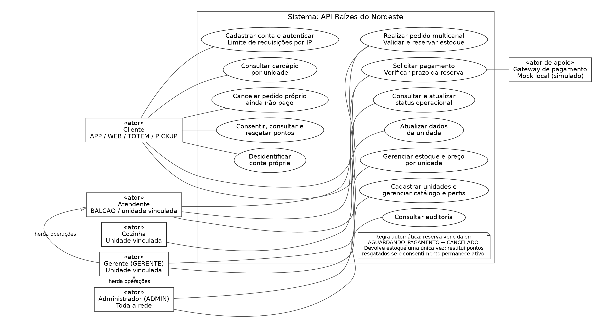
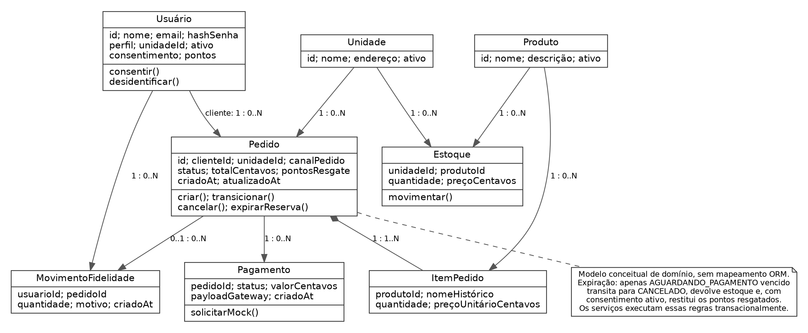
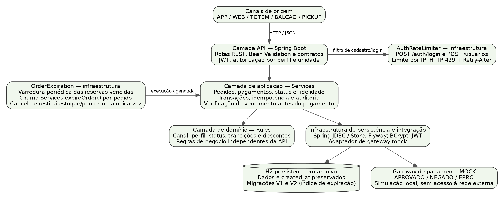
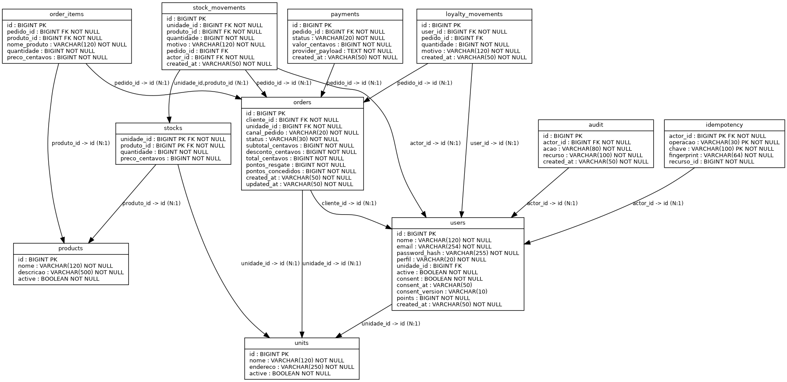
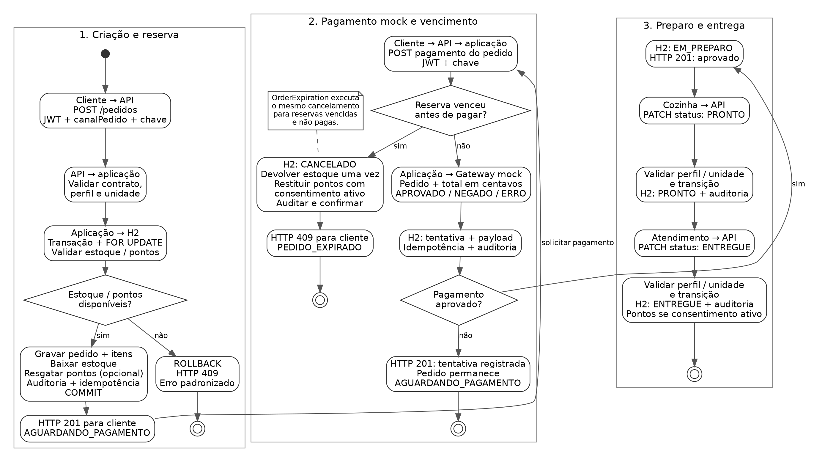

# 1. Introdução e objetivos

A rede de lanchonetes Raízes do Nordeste precisa integrar unidades com cardápio e estoque próprios, atendendo os canais APP, TOTEM, BALCAO, PICKUP e WEB. Esta implementação acadêmica oferece uma API REST persistente para centralizar pedidos, pagamento simulado, operação da cozinha e fidelização. O canal de origem é obrigatório e consultável, permitindo acompanhamento operacional. O objetivo principal é completar o fluxo pedido → pagamento mock → preparo → entrega, com validação de estoque, autorização por perfil e unidade, rastreabilidade e proteção contra efeitos duplicados.

O trabalho foi desenvolvido a partir do estudo de caso da rede Raízes do Nordeste e das orientações da Trilha Back-End (UNINTER, 2026). O escopo prioriza um produto mínimo viável (MVP) executável, com decisões técnicas fundamentadas nos requisitos do negócio. Os atores são cliente, atendente, cozinha, gerente, administrador e gateway de pagamento simulado. Os exemplos e dados do seed são fictícios; não representam uma operação comercial em produção.

Esta revisão acompanha a implementação da branch main no commit 21ad11e, de 12 de outubro de 2026. Esse commit preserva a árvore de código do antigo 601cc43, no histórico consolidado, com autoria Git jefersonrivaldo. Além do fluxo original, a versão atual corrige respostas HTTP, expira reservas de pedidos não pagos, limita tentativas nos endpoints públicos de autenticação, reduz consultas repetidas na listagem de pedidos e inclui configuração de integração contínua. Os objetivos específicos são preservar a consistência entre pedido, estoque e pontos; manter contratos coerentes com o código; demonstrar o funcionamento por testes reproduzíveis; e distinguir recursos implementados de evoluções propostas.

# 2. Análise e requisitos

## 2.1 Requisitos funcionais e prioridades

Os requisitos RF01–RF14 preservam a análise original. O requisito RF15 registra a expiração de reservas, acrescentada à implementação atual. As prioridades e evidências descrevem o MVP efetivamente entregue; recursos propostos não são apresentados como funcionalidades disponíveis.

Tabela 1 — Requisitos funcionais e prioridades

| ID | Requisito | Prioridade, estado e evidência |
| --- | --- | --- |
| RF01 | Cadastro e autenticação por token; autorização por perfil | Essencial e implementado. POST /usuarios cria CLIENTE; POST /auth/login emite JWT; senhas usam BCrypt. |
| RF02 | Gestão da rede e das unidades | Essencial e implementado. ADMIN cadastra e atualiza unidades; GERENTE atualiza somente sua unidade. |
| RF03 | Catálogo global e cardápio por unidade | Essencial e implementado. Produtos globais, preços locais em centavos, disponibilidade e estoque por unidade. |
| RF04 | Criação e consulta de pedidos com itens e canalPedido | Essencial e implementado. Canal obrigatório, preços calculados no servidor e filtros por canal e status. |
| RF05 | Atualização de status e cancelamento | Essencial e implementado. Máquina de estados, autorização operacional e devoluções sem duplicidade. |
| RF06 | Estoque por unidade e movimentos | Essencial e implementado. Operações transacionais, saldo não negativo e histórico de movimentações. |
| RF07 | Pagamento externo simulado e registro de retorno | Essencial e implementado por gateway mock desacoplado. Aprovação, negativa, indisponibilidade e estorno simulado; várias tentativas são persistidas. |
| RF08 | Fidelidade com consentimento e resgate | Implementado. Um ponto por real efetivamente pago na entrega; resgate de 100 pontos corresponde a R$ 10. |
| RF09 | Promoção ou campanha | Implementado de forma restrita. Cupom NORDESTE10 aplica 10% sobre subtotal mínimo de R$ 50; não há gestão de vigência dinâmica. |
| RF10 | Privacidade e auditoria | Implementado no MVP. Leitura de dados próprios, retirada de consentimento, desidentificação e auditoria de operações e consultas sensíveis. |
| RF11 | Indicadores consolidados da matriz | Proposto. Vendas por unidade ou região, produtos mais vendidos e relatórios financeiros requerem implementação adicional e acesso restrito à gestão. |
| RF12 | Variações e sazonalidade do cardápio | Parcial. Disponibilidade e preços locais implementados; vigência sazonal e receitas regionais propostas. |
| RF13 | Campanhas segmentadas | Proposto. Segmentação por frequência com consentimento específico; coleta de idade não integra o MVP. |
| RF14 | Regras de funcionamento por unidade | Proposto. Horários, capacidade da cozinha e metas operacionais demandam modelagem adicional. |
| RF15 | Expiração de reservas sem pagamento | Implementado. Pedidos em AGUARDANDO_PAGAMENTO vencem após prazo configurável; cancelamento automático restitui estoque uma vez e pontos quando o consentimento permanece ativo. |

Fonte: elaboração com base nos artefatos do projeto Raízes do Nordeste (2026).

## 2.2 Requisitos não funcionais e decisões técnicas

Os requisitos RNF01–RNF08 preservam as decisões originais, atualizadas à versão atual. RNF09–RNF11 explicitam os controles acrescentados nesta revisão.

Tabela 2 — Requisitos não funcionais e decisões técnicas

| ID | Requisito não funcional | Decisão técnica e limite |
| --- | --- | --- |
| RNF01 | Segurança | JWT HS256 com expiração, BCrypt com custo 12, autorização por perfil e vínculo com unidade. HTTPS deve ser configurado no deploy. |
| RNF02 | Integridade | PK, FK, CHECK e UNIQUE; transações Spring JDBC e bloqueios FOR UPDATE. Estoque, pontos, pedido e idempotência confirmam juntos. |
| RNF03 | Rastreabilidade | Auditoria de operações sensíveis e leituras; requestId por resposta. Credenciais e corpos de requisição não integram os registros de auditoria. |
| RNF04 | Documentação | Swagger em /docs, OpenAPI exportado, contratos tipados, exemplos e coleção Postman. Geração de contratos disponível no modo --api-only. |
| RNF05 | Desempenho | Paginação até 100 registros, índices de busca e carregamento conjunto dos itens de uma página de pedidos. Há testes de concorrência; não há validação de carga comercial. |
| RNF06 | Disponibilidade | Healthcheck consulta o banco. H2 em arquivo simplifica a execução local, mas não oferece alta disponibilidade validada. |
| RNF07 | Tolerância a falhas | Indisponibilidade mock gera tentativa ERRO; nova chave permite nova tentativa. Cozinha só é autorizada após pagamento aprovado. A varredura processa cada pedido em transação independente. |
| RNF08 | Reprodutibilidade | Java 21, Maven 3.9+, versões fixadas, checksums estritos, migrations versionadas, seed idempotente e testes isolados da base de desenvolvimento. |
| RNF09 | Semântica HTTP e diagnóstico | Método incompatível gera 405 com Allow; mídia de corpo incompatível gera 415; representação indisponível gera 406. Erros mantêm envelope JSON com requestId. |
| RNF10 | Controle de tentativas de autenticação | Login e cadastro compartilham orçamento por IP de conexão: padrão de 20 tentativas em 60 segundos; excesso gera 429 com Retry-After. Controle local à instância, limitado a 10.000 endereços ativos. |
| RNF11 | Verificação contínua e manutenção | Workflow GitHub Actions configurado para Java 21 e Maven 3.9; relatórios Surefire são publicados como artefatos. Dependabot acompanha Maven e Actions mensalmente. Execução remota do workflow não foi confirmada nesta revisão. |

Fonte: elaboração com base nos artefatos do projeto Raízes do Nordeste (2026).

O H2 persistente em arquivo permite estudar e executar a aplicação sem um servidor de banco externo. Transações e bloqueios protegem estoque e fidelidade. O pagamento mock demonstra aprovação, recusa e indisponibilidade sem coletar dados de cartão. Uma implantação comercial exige avaliar banco servidor, backups, restauração, monitoramento, proteção de tráfego e capacidade de carga.

O projeto prioriza a consistência da venda e a prevenção de saldo negativo e efeitos duplicados. Indicadores gerenciais, sazonalidade e campanhas segmentadas permanecem como evoluções. Os testes de concorrência verificam regras do MVP e não demonstram alta disponibilidade ou desempenho em produção.

# 3. Modelagem e arquitetura

## 3.1 Organização em camadas

Os diagramas estão em docs/diagramas/: casos de uso, entidade-relacionamento, classes conceituais e arquitetura, com artefatos SVG e PNG e fontes DOT. O DER também possui versão PDF. A sequência do fluxo crítico está em docs/sequencia.md. Os apêndices desta entrega apresentam as representações correspondentes.

A camada API contém controllers, DTOs Java, Bean Validation, autenticação integrada e tratamento uniforme de erros. Application orquestra casos de uso, transações, autorização por recurso e gateway. Domain define enums, transições, preços e regras de cupom e resgate. Infrastructure reúne JDBC, H2, migrations Flyway, hashing, JWT, seed, gateway mock e agendamento da expiração. A aplicação usa Java 21 e Spring Boot 3.5.6, com Spring Security, Spring JDBC e JUnit 5 nos testes.

O domínio utiliza funções, registros e dados persistentes. O diagrama de classes apresenta uma visão conceitual das entidades e suas relações, não uma implementação de ORM ou DDD completo. Os scripts shell apenas iniciam Maven e JVM; aplicação, testes e ferramentas de documentação são implementados em Java. A coleção inclui JavaScript por exigência do formato Postman, mas também é percorrida por um executor Java.

## 3.2 Modelo de dados e integridade

Uma unidade possui vários produtos em estoque e um produto pode existir em várias unidades. A tabela stocks usa chave primária composta por unidade_id e produto_id. Usuários possuem pedidos, movimentos de fidelidade e registros de auditoria. Cada pedido pertence a uma unidade, possui itens e admite tentativas de pagamento independentes. Os itens preservam nome e preço históricos do produto. Chaves de idempotência são únicas por ator, operação e chave.

Tabela 3 — Modelo de dados e integridade

| Tabela | Chaves e relacionamentos | Integridade relevante |
| --- | --- | --- |
| units e products | PK id; cadastros de unidades e catálogo | Desativação preserva histórico de vendas e referências. |
| users | PK id; FK unidade_id opcional para equipe | Email único, perfil limitado e saldo de pontos não negativo. CLIENTE e ADMIN não recebem vínculo operacional com unidade. |
| stocks | PK composta unidade_id/produto_id; FK para units e products | Quantidade não negativa e preço positivo. |
| orders | PK id; FK cliente_id e unidade_id | Canal e status limitados por CHECK; total não negativo; created_at permite calcular vencimento. |
| order_items | PK id; FK pedido_id e produto_id | Produto único por pedido; quantidade e preço positivos; nome e preço preservados. |
| payments | PK id; FK pedido_id | Várias tentativas por pedido; status atual e payload original persistidos. |
| stock_movements | PK id; FK composta para stocks; FK para ator e pedido | Movimentação vinculada ao recurso, ao pedido e ao responsável. |
| loyalty_movements | PK id; FK user_id e pedido_id opcional | Créditos e débitos rastreáveis, inclusive devolução de resgate. |
| audit | PK id; FK actor_id | Ação, recurso e instante; sem credenciais. |
| idempotency | PK ator/operação/chave; FK actor_id | Fingerprint impede reutilizar uma chave com conteúdo diferente. |

Fonte: elaboração com base nos artefatos do projeto Raízes do Nordeste (2026).

A migration V1__initial.sql define as 11 tabelas da aplicação, chaves, restrições e índices originais. A tabela flyway_schema_history registra separadamente o controle de migrations. A nova V2__order_expiration_index.sql acrescenta idx_orders_expiration sobre orders(status, created_at). A V1 foi preservada: o Flyway valida seus checksums e aplica apenas a migration pendente. O teste de migração atual cria uma base V1, grava um registro, reabre o arquivo, aplica V2 e verifica a preservação dos dados e a existência do índice. Não foi realizado estudo de planos de execução ou benchmark de carga.

## 3.3 Fluxo crítico: pedido e pagamento

Atores: cliente nos canais APP, WEB, TOTEM e PICKUP; atendimento no canal BALCAO; cozinha; gerente ou administrador; e gateway mock. TOTEM representa um canal de pedido autenticado, não compra anônima.

Pré-condições: usuário ativo autenticado, unidade ativa, produtos ativos ofertados e disponíveis, cliente válido, canal válido e Idempotency-Key. Atendente ou gerente informa clienteId e atua somente na unidade vinculada. Cliente atua sobre seus próprios pedidos. Os preços e descontos são calculados no servidor.

1. A API valida canalPedido, itens, quantidades e chave de idempotência. Valores monetários enviados pelo cliente não determinam o preço da venda.

2. Uma transação bloqueia os usuários envolvidos em ordem crescente de ID, verifica estoque, consentimento e saldo para eventual resgate, cria pedido e itens, registra saídas de estoque e débito de pontos e persiste auditoria e idempotência.

3. O pedido inicia em AGUARDANDO_PAGAMENTO. O cliente solicita pagamento mock com chave própria para essa operação.

4. O gateway retorna resultado e payload. A tentativa é persistida; apenas APROVADO altera o pedido para EM_PREPARO.

5. Cozinha ou atendimento autorizado marca PRONTO. Atendimento, gerente ou administrador autorizado marca ENTREGUE.

6. Na entrega, cliente com consentimento ativo recebe a divisão inteira de totalCentavos por 100 em pontos. A transição terminal impede novo crédito pela repetição da entrega.

Pós-condições: pedido e canal são consultáveis, estoque está atualizado, tentativa de pagamento e auditoria estão persistidas. O saldo de fidelidade aumenta somente após a entrega. O reenvio com mesma chave e conteúdo retorna o recurso existente em seu estado atual, sem repetir efeitos, e exige autorização atual sobre ele.

As mutações de pedidos seguem a mesma ordem de bloqueios: usuários em ordem crescente de ID, pedido e linhas de estoque em ordem de produto. Criação e devolução também ordenam produtos. Isso reduz disputas e evita inversões entre pagamento, cancelamento, entrega, consentimento e expiração. Transações continuam necessárias para confirmar ou desfazer todos os efeitos da operação.

## 3.4 Cancelamento, expiração e fidelidade

Cancelamento antes da entrega devolve estoque exatamente uma vez. Pagamento aprovado recebe status ESTORNADO mock. Cliente cancela somente enquanto o pedido aguarda pagamento; equipe de atendimento autorizada pode cancelar EM_PREPARO ou PRONTO. Cozinha pode apenas marcar PRONTO. ENTREGUE e CANCELADO são terminais; não há cancelamento de pedido entregue no MVP.

Pontos resgatados são restituídos no cancelamento quando o consentimento continua ativo. Revogar o consentimento zera o saldo e impede novos créditos e devoluções enquanto ele permanece revogado. O desconto já aplicado ao pedido não é retirado.

A expiração automática está implementada para pedidos que permanecem em AGUARDANDO_PAGAMENTO. ORDER_RESERVATION_TTL_SECONDS define o prazo, com padrão de 1800 segundos (30 minutos). ORDER_EXPIRATION_SCAN_MS define a varredura, com padrão de 60000 milissegundos (um minuto). O agendador inicia após esse intervalo e repete a varredura com o mesmo atraso entre execuções; cada pedido é processado em transação independente.

O vencimento é calculado com created_at persistido, por isso funciona após reiniciar a API. A expiração usa o status existente CANCELADO, sem criar um novo estado de pedido. Registra o movimento de estoque CANCELAMENTO_EXPIRACAO e o evento de auditoria PEDIDO_EXPIRADO, com eventual devolução de pontos. Pedidos já pagos não expiram por esse mecanismo.

O pagamento também verifica o prazo dentro da operação transacional. Uma nova tentativa após o vencimento provoca cancelamento e devoluções, confirma esses efeitos e só então retorna HTTP 409 com PEDIDO_EXPIRADO, evitando rollback da liberação. O reenvio de uma tentativa já registrada continua retornando essa tentativa com a mesma chave; ele não cria nem aprova um pagamento novo. Os testes verificam disputas entre expiração, pagamento e cancelamento e a prevenção de devolução duplicada.

A listagem paginada de pedidos carrega seus itens em uma consulta conjunta para os IDs da página, reduzindo as consultas repetidas por pedido. O limite de paginação permanece de 100 registros. Esse ajuste não substitui medição de desempenho em ambiente comercial.

# 4. API e contratos

Os contratos estão em docs/api.md e docs/openapi.json, com acesso interativo por /docs. Endpoints, parâmetros, permissões e exemplos derivam do OpenAPI da aplicação. A atribuição de perfis é exclusiva de ADMIN; cadastro público cria somente CLIENTE. Exemplos de CLIENTE usam unidadeId: null. Apenas perfis operacionais ATENDENTE, COZINHA e GERENTE exigem vínculo com unidade.

Listagens retornam items, page e limit. Valores monetários usam centavos inteiros em long, evitando erros de ponto flutuante. IDs históricos são preservados; unidades e produtos são desativados por ativo=false, sem apagar vendas. Nos contratos correspondentes, o corpo de entrada usa ativo e a resposta representa esse campo como active. Idempotency-Key tem de 8 a 100 caracteres alfanuméricos, ponto, hífen ou sublinhado.

## 4.1 Estados e idempotência

A sequência normal é AGUARDANDO_PAGAMENTO → EM_PREPARO, exclusivamente por pagamento aprovado → PRONTO → ENTREGUE. CANCELADO é terminal e também representa a expiração de reserva. Não há salto direto de AGUARDANDO_PAGAMENTO para PRONTO ou ENTREGUE. NEGADO e ERRO são estados da tentativa de pagamento; não são estados do pedido.

Criar uma tentativa mock retorna HTTP 201 mesmo quando o gateway nega ou fica indisponível, pois a tentativa foi registrada. O cliente precisa examinar APROVADO, NEGADO ou ERRO no corpo. Nova tentativa utiliza nova chave. Mesma chave e mesmo conteúdo retornam o recurso existente; mesma chave com conteúdo diferente gera 409. A autorização atual é verificada também no reenvio, inclusive após transferência de unidade de um empregado.

Em pagamentos, status representa o estado atual da tentativa. Se a venda for cancelada depois da aprovação, status torna-se ESTORNADO, enquanto payload mantém a resposta original APROVADO do gateway mock. Essa diferença preserva a informação recebida do provedor e o resultado atual da operação; não representa contradição no contrato.

## 4.2 Respostas HTTP e envelope de erro

O padrão é {error, message, details:[{field,issue}], timestamp, path, requestId}. Detalhes de validação omitem valores de entrada para não repetir senhas. A API também retorna X-Request-ID, Cache-Control: no-store e X-Content-Type-Options: nosniff. Os exemplos completos constam do Apêndice A.

Tabela 4 — Respostas HTTP e envelope de erro

| HTTP | Situação | Comportamento |
| --- | --- | --- |
| 401 | Falta de autenticação ou token inválido | Envelope JSON; não libera recursos protegidos. |
| 403 | Perfil, unidade ou titularidade incompatível | Autorização negada sobre a operação ou recurso. |
| 404 | Recurso inexistente | Erro uniforme para unidade, produto, pedido ou rota inexistente. |
| 405 | Método HTTP incompatível | METODO_NAO_PERMITIDO e cabeçalho Allow. POST /health recebe 405. |
| 406 | Accept sem representação disponível | TIPO_MIDIA_NAO_ACEITAVEL; envelope de diagnóstico em JSON. |
| 409 | Regra de negócio ou integridade | Estoque ou pontos insuficientes, cupom inválido, transição proibida, chave incompatível ou nova tentativa em pedido expirado. |
| 415 | Tipo de mídia de corpo incompatível | TIPO_MIDIA_NAO_SUPORTADO, preservando cabeçalhos relevantes. |
| 422 | Corpo, parâmetros, cabeçalhos ou campos inválidos | VALIDACAO; inclui detalhes quando há falha de validação de campos. |
| 429 | Orçamento de login e cadastro excedido | LIMITE_REQUISICOES e Retry-After em segundos. |
| 503 | Bloqueio de banco indisponível | BANCO_OCUPADO; cliente pode tentar novamente. |

Fonte: elaboração com base nos artefatos do projeto Raízes do Nordeste (2026).

Erros internos inesperados continuam usando 500 com mensagem genérica e requestId. Nem todos os códigos se aplicam a toda rota; autenticação e o limitador podem impedir que a requisição chegue ao controller. O healthcheck correto é GET /health e retorna status e resultado da consulta ao banco.

# 5. LGPD, privacidade, segurança e auditoria

## 5.1 Dados, consentimento e direitos

Dados coletados: nome, email e hash de senha para identificação e autenticação; identificador interno, itens, unidade, canal, preços e datas para executar e acompanhar pedidos; perfil e unidade de empregados para autorização; consentimento, versão 1.0, instante e movimentos de pontos para fidelização. Não são coletados CPF, telefone, endereço residencial ou dados de cartão. Endereços de unidades no seed são comerciais e fictícios.

A análise considera a execução de contrato para conta e pedidos e o consentimento facultativo para fidelidade. O sistema registra decisão, versão e instante do consentimento. A revogação por PUT /fidelidade/consentimento zera pontos, gera movimento e auditoria e impede novos créditos ou devoluções enquanto estiver revogada. A definição e documentação das bases legais e dos prazos de retenção são responsabilidades do controlador em uma operação real, conforme a LGPD (BRASIL, 2018).

DELETE /usuarios/me exige perfil CLIENTE e ausência de pedido em aberto. Nome, email e hash são substituídos, consentimento retirado, saldo zerado e conta desativada; tokens existentes deixam de funcionar. IDs e histórico operacional permanecem. O resultado é desidentificação ou pseudonimização local, sem garantia de anonimização irreversível em sistemas externos.

A retenção proposta envolve revisar contas inativas e necessidade de dados, considerar 180 dias para auditoria de desenvolvimento conforme finalidade e obrigações aplicáveis e manter vendas pelo prazo definido pelo controlador. Limpeza automática por prazo não está implementada. Exportação pessoal, gestão formal de solicitações LGPD e descarte de backups exigem processo operacional futuro.

## 5.2 Autenticação e autorização

Senhas usam BCrypt com salt aleatório por usuário e custo 12, com verificação pelo encoder; nunca são retornadas pela API. JWT usa HS256 e exige sub, iat, exp, iss e aud. A expiração padrão é de 3600 segundos, configurável por TOKEN_TTL_SECONDS de 1 a 86400. JWT_SECRET precisa ter ao menos 32 bytes; InitLocal.java gera um segredo aleatório local de 256 bits e senha inicial sem expor valores.

O perfil e o estado ativo são consultados no banco a cada requisição. Mudança de perfil, transferência de unidade e desativação aplicam-se também a tokens emitidos anteriormente. Clientes acessam recursos próprios; empregados atuam na unidade atribuída; ADMIN administra a rede. A chave local fica em .env, ignorado pelo Git e com permissão 0600 quando suportada. Esse arquivo não integra a entrega pública.

O orçamento combinado de POST /auth/login e POST /usuarios usa o IP da conexão, obtido por getRemoteAddr. Por padrão, aceita 20 requisições por janela de 60 segundos, incluindo tentativas válidas e inválidas. Excesso gera 429 com Retry-After. Os valores podem ser alterados por AUTH_RATE_LIMIT_MAX_REQUESTS e AUTH_RATE_LIMIT_WINDOW_SECONDS.

O limitador mantém no máximo 10.000 endereços com janela ativa. Remove janelas vencidas e, quando está cheio, nega novos endereços até haver capacidade, sem expulsar clientes ativos para reiniciar seu orçamento. O controle é em memória, por instância da JVM, e reinicia com o processo. Não há quota compartilhada entre réplicas. X-Forwarded-For não é usado para identificar o cliente; uma implantação atrás de proxy precisa definir confiança no proxy e proteção no ponto de entrada, pois múltiplos usuários podem compartilhar o mesmo IP observado.

## 5.3 Auditoria e limites para produção

Leituras de perfil, pedidos, pagamentos, fidelidade e auditoria e eventos de criação, status, estoque, consentimento e expiração registram IDs, ação e instante. A auditoria não grava senha, token, email, corpo de requisição ou dados de cartão. GET /auditoria é exclusivo de ADMIN. Eventos de erro mantêm requestId para diagnóstico sem retornar stack trace ao cliente.

A evolução para produção exige HTTPS, gestão central de segredos, controle de tráfego distribuído, monitoramento, backups, restauração testada, retenção operacional e eventual banco servidor. O limitador atual acrescenta uma proteção básica contra excesso de tentativas; não demonstra proteção completa contra ataques distribuídos. A validação cobre o ambiente local e não comprova capacidade ou disponibilidade de uma operação comercial.

# 6. Plano de testes e evidências

## 6.1 Resultado atual

A execução local de ./scripts/mvn.sh verify em 12 de outubro de 2026 aprovou 62 testes, com zero falhas, zero erros e zero testes pulados. A versão de referência é o commit 21ad11e. O Maven compilou a aplicação e executou a suíte JUnit; o resultado foi BUILD SUCCESS. Os relatórios desta execução estão em target/surefire-reports. O Apêndice C apresenta a consolidação das evidências.

Tabela 5 — Resultados das suítes de teste

| Suíte | Quantidade | Evidência e alcance |
| --- | --- | --- |
| Integração da API | 32 | Fluxo principal, estoque, idempotência, perfis e unidades, fidelidade, pagamento mock e autorização atual no reenvio. |
| Erros HTTP | 4 | Respostas de método, mídia e representação, incluindo a regressão POST /health → 405 e manutenção do JSON de erro. |
| Expiração de reservas | 14 | Reserva vencida, estoque, pontos, consentimento, persistência do prazo, pedidos pagos e concorrência entre expiração, pagamento e cancelamento. |
| Limite de autenticação | 7 | Orçamento combinado, isolamento por endereço, janelas, Retry-After, relógio e capacidade limitada do armazenamento. |
| Documentação | 3 | Exemplos coerentes com perfis, modo --api-only e falha segura do modo completo quando falta a fonte do relatório. |
| Migração do banco | 1 | Banco H2 em arquivo; atualização V1→V2, validação de checksums, preservação de dados e índice de expiração. |
| Contrato da coleção | 1 | Percorre as 23 requisições da coleção em sete pastas, com 46 grupos de asserções equivalentes ao fluxo Postman. |

Fonte: elaboração com base nos artefatos do projeto Raízes do Nordeste (2026).

Correspondência com os nomes técnicos das suítes: Integração da API (ApiIntegrationTest); Erros HTTP (HttpErrorIntegrationTest); Expiração de reservas (OrderExpirationIntegrationTest); Limite de autenticação (AuthRateLimitIntegrationTest); Documentação (DocumentationTest); Migração do banco (DatabaseMigrationTest); Contrato da coleção (CollectionContractTest).

Os testes HTTP usam servidor real em porta aleatória e H2 em memória exclusivo. A suíte do limite também usa MockMvc e relógio controlado. O teste de migração utiliza arquivo H2 em diretório temporário. Os testes não alteram o banco local de desenvolvimento. As evidências comprovam os cenários executados, sem equivaler a uma auditoria completa de segurança ou a teste de carga em produção.

## 6.2 Coleção e evidências históricas

A coleção Postman reúne 23 cenários em sete pastas, com asserções de status e conteúdo. docs/plano-testes.md relaciona entradas, pré-condições, resultados esperados e critérios de aceitação. O executor Java percorre essas requisições recursivamente; 46 grupos de asserções correspondem ao contrato da coleção e não representam 46 testes JUnit adicionais.

Para reproduzir no Postman, definir baseUrl e adminPassword em ambiente privado, usar o seed documentado e executar T01–T23 em ordem. Cliente e chaves são gerados para a execução. A coleção movimenta duas unidades do produto 1 no banco utilizado. Importar a coleção não comprova sucesso; é necessário executá-la e conservar resultados sanitizados.

Os arquivos versionados `docs/evidencias-junit-*.xml` e `docs/evidencias-*.json` preservam execuções anteriores e não substituem os relatórios atuais. A evidência Newman 6.2.1 em docs/evidencias-postman-newman.json registra 23 requisições, 46 asserções e zero falhas em 11 de outubro de 2026, às 21:17:20 UTC, com base de revisão 07566134fbda88e93923c58b6dd407f999ba24ba. Essa execução é histórica: Newman não foi novamente executado nesta atualização. A suíte atual valida a coleção pelo executor Java, sem exigir Node ou Newman.

## 6.3 Integração contínua

O workflow .github/workflows/ci.yml está configurado para pushes em main e pull requests, com Java 21, verificação de Maven 3.9 e mvn --batch-mode --strict-checksums verify. Actions são fixadas por SHA, permissões limitam-se à leitura e relatórios Surefire são guardados como artefatos por 14 dias, inclusive em falha de teste. A configuração foi inspecionada; o resultado remoto de uma execução no GitHub Actions não foi confirmado nesta revisão. O resultado de 62 testes informado neste relatório provém da execução local registrada.

# 7. Entrega técnica

A entrega reúne código Java, migrations V1 e V2, seed idempotente, scripts de execução, pom.xml, .env.example, README, OpenAPI, contratos, coleção, plano de testes, diagramas e configurações CI e Dependabot. Os apêndices apresentam contratos, cenários, evidências e diagramas. O código está em <https://github.com/jefersonrivaldo/raizes-do-nordeste>, na branch main. Esta revisão acadêmica referencia o commit 21ad11e, cujo título é “Corrige API, expira reservas e adiciona proteção de autenticação”.

Os arquivos acadêmicos revisados são distribuídos separadamente do código da aplicação. Eles não incluem .env, credenciais, tokens ou banco de desenvolvimento. Nome, RU, instituição, curso, disciplina, período e professora preservam a identificação fornecida no material original. O polo de apoio e a cidade informados para a entrega são Cariacica/ES.

## 7.1 Reprodução da aplicação

Requisitos: JDK 21, incluindo java e javac; Maven 3.9.11 ou versão compatível 3.9+; e Bash para os scripts. H2 é instalado como dependência Maven e não precisa de serviço separado. Graphviz e fontes Liberation Serif e DejaVu são opcionais, apenas para regenerar diagramas e PDF. Usar o checkout existente; tarefas em nuvem já possuem ambiente isolado, sem necessidade de criar worktree.

```bash
./scripts/toolchains.sh
./scripts/mvn.sh verify
/workspace/toolchains/jdk/jdk-21.0.8+9/bin/java scripts/InitLocal.java
./scripts/start.sh
```

toolchains.sh prepara JDK e Maven quando necessário; InitLocal.java cria configuração privada sem sobrescrever .env existente. No ambiente de nuvem, caso java aponte para outra versão, pode-se usar o binário do JDK preparado em /workspace/toolchains/jdk/jdk-21.0.8+9/bin/java. start.sh carrega .env e inicia a JVM. Ao usar java -jar diretamente, as variáveis precisam estar no ambiente do processo, pois a JVM não lê .env automaticamente.

A aplicação aplica Flyway e seed automaticamente. O seed cria admin@raizes.local, duas unidades, três produtos e 100 unidades de estoque por produto e unidade, sem redefinir senhas ou saldos existentes. O banco persistente padrão é data/raizes.mv.db e sobrevive a reinícios. PORT define a porta, com padrão 8000. As demais variáveis estão em .env.example, incluindo prazo da reserva, intervalo de expiração e limite de autenticação.

Swagger local: <http://localhost:8000/docs>. OpenAPI: <http://localhost:8000/openapi.json>. Healthcheck: <http://localhost:8000/health>. Essas URLs funcionam após iniciar a aplicação na máquina do avaliador. A coleção está em <https://github.com/jefersonrivaldo/raizes-do-nordeste/blob/main/docs/postman_collection.json>. O repositório e a coleção responderam HTTP 200 na verificação histórica registrada em 11 de outubro de 2026; esse registro não comprova um deploy da API. Não foi realizado deploy público.

## 7.2 Documentação e manutenção

O modo --api-only permite regenerar docs/api.md e docs/openapi.json sem exigir docs/relatorio.md, Graphviz ou fontes de PDF. Após iniciar a API e preparar o classpath:

```bash
./scripts/mvn.sh test-compile org.apache.maven.plugins:maven-dependency-plugin:3.8.1:build-classpath -Dmdep.includeScope=test -Dmdep.outputFile=target/docs-classpath.txt
java -cp "target/test-classes:target/classes:$(cat target/docs-classpath.txt)" br.com.raizes.Documentation --api-only
```

O modo completo exige a fonte docs/relatorio.md, agora versionada e correspondente ao relatório revisado, com 40 tabelas, cinco diagramas e a declaração de uso de IA solicitada. O gerador Java lê essa fonte completa e produz output/4937546_Projeto_Back_End_JAVA.pdf como conferência independente do conteúdo. O PDF de entrega e a versão Word editável ficam em output, separados dos arquivos da aplicação.

Dependabot acompanha mensalmente dependências Maven e GitHub Actions. Seu arquivo de configuração não equivale a atualização automática já concluída nem comprova a ausência de vulnerabilidades; alertas dependem das configurações do repositório e as mudanças devem passar por revisão e testes.

# 8. Conclusão

O desenvolvimento da API Raízes do Nordeste alcançou o objetivo de integrar o fluxo de pedidos dos canais APP, TOTEM, BALCAO, PICKUP e WEB, com persistência, estoque por unidade, pagamento simulado e acompanhamento do preparo até a entrega. Registro do canal, auditoria e contratos documentados permitem rastrear e reproduzir as operações do MVP.

A modelagem de casos de uso, classes e relacionamentos orientou os endpoints e as regras de negócio. A separação entre domínio, aplicação, infraestrutura e API tornou explícitas as responsabilidades. Java 21, Spring Boot, JDBC, H2 e Flyway viabilizaram uma solução local executável, com integridade referencial e estrutura de dados versionada. A migration V2 acrescenta o índice de expiração preservando a V1 e os dados existentes.

Os principais desafios envolveram consistência entre pedidos, estoque e fidelidade, concorrência e prevenção de efeitos duplicados. Transações, ordem consistente de bloqueios e chaves de idempotência protegem essas operações. A expiração automática agora libera reservas não pagas e impede novas aprovações tardias sem desfazer as devoluções. O pagamento mock demonstra aprovação, recusa, indisponibilidade e estorno sem depender de um provedor financeiro real.

A autenticação JWT, as permissões por perfil e unidade, BCrypt, auditoria e o orçamento de tentativas compõem os controles de segurança atuais. O consentimento facultativo, a minimização de dados e a desidentificação incorporam cuidados de privacidade, com os limites próprios de uma implementação acadêmica. A correção da semântica HTTP e dos exemplos melhora a correspondência entre código e documentação.

A suíte local atual aprovou 62 testes, incluindo expiração, concorrência, limite de autenticação, erros HTTP, migração e coleção. A configuração de CI oferece um caminho de verificação contínua, sem atribuir a ela um resultado remoto não confirmado. Permanecem como evoluções indicadores gerenciais, campanhas segmentadas, sazonalidade, pagamento e reembolso reais, compra anônima, revogação individual de sessão, proteção distribuída, backup, retenção automática e alta disponibilidade. A solução constitui uma base funcional para essas melhorias, sem atribuir ao ambiente local capacidades de produção que não foram validadas.

# REFERÊNCIAS

::: {.references custom-style="Bibliography"}

BRASIL. Lei nº 13.709, de 14 de agosto de 2018 (Lei Geral de Proteção de Dados Pessoais). Disponível em: <https://www.planalto.gov.br/ccivil_03/_ato2015-2018/2018/lei/l13709.htm>.

H2. Documentação do banco H2. [S. l.], [s. d.]. Disponível em: <https://h2database.com/html/main.html>.

OWASP. Password Storage Cheat Sheet. [S. l.], [s. d.]. Disponível em: <https://cheatsheetseries.owasp.org/cheatsheets/Password_Storage_Cheat_Sheet.html>.

SPRING. Documentação oficial do Spring Boot. [S. l.], [s. d.]. Disponível em: <https://docs.spring.io/spring-boot/>.

UNINTER. Projeto Multidisciplinar: orientações e estudo de caso — rede Raízes do Nordeste. 2026.

UNINTER. Projeto Multidisciplinar: trilha Back-End — rede Raízes do Nordeste. 2026.

:::


# APÊNDICE A — CONTRATOS E EXEMPLOS DA API

Os contratos abaixo correspondem ao OpenAPI versionado do projeto. Exemplos são ilustrativos; valores monetários são expressos em centavos.


Gerado do OpenAPI real do Spring Boot. Exemplos são ilustrativos. Valores em centavos; listagens retornam items/page/limit (limit até 100). Idempotency-Key tem 8–100 caracteres alfanuméricos, ponto, hífen ou sublinhado. Equipe informa clienteId na criação de pedido. Reenvio idempotente retorna estado atual.

## PUT /usuarios/{id}/perfil

Atribuir perfil e unidade (ADMIN)


Autenticação: JWT Bearer; perfil/unidade conforme resumo.

Parâmetros:

Tabela 6 — PUT /usuarios/{id}/perfil

| Nome | Local | Obrigatório | Contrato |
|---|---|---|---|
| id | path | true | {"type": "integer", "format": "int64"} |

Fonte: artefatos documentais do projeto Raízes do Nordeste (2026).


Request:

```json
{
  "perfil" : "CLIENTE",
  "unidadeId" : null
}
```

Response HTTP 200:

```json
{
  "id" : 2,
  "nome" : "Maria de estudo",
  "perfil" : "CLIENTE",
  "unidadeId" : null
}
```

Erros: 401 autenticação, 403 autorização, 404 inexistente, 405 método HTTP, 406 representação, 409 regra/integridade, 415 tipo de conteúdo, 422 validação, 503 banco ocupado; JSON ErrorResponse uniforme. Nem todos os erros se aplicam a toda rota.

## PUT /unidades/{id}

Atualizar unidade (ADMIN ou GERENTE da unidade)


Autenticação: JWT Bearer; perfil/unidade conforme resumo.

Parâmetros:

Tabela 7 — PUT /unidades/{id}

| Nome | Local | Obrigatório | Contrato |
|---|---|---|---|
| id | path | true | {"type": "integer", "format": "int64"} |

Fonte: artefatos documentais do projeto Raízes do Nordeste (2026).


Request:

```json
{
  "nome" : "texto",
  "endereco" : "texto",
  "ativo" : true
}
```

Response HTTP 200:

```json
{
  "id" : 1,
  "nome" : "texto",
  "endereco" : "texto",
  "active" : true
}
```

Erros: 401 autenticação, 403 autorização, 404 inexistente, 405 método HTTP, 406 representação, 409 regra/integridade, 415 tipo de conteúdo, 422 validação, 503 banco ocupado; JSON ErrorResponse uniforme. Nem todos os erros se aplicam a toda rota.

## PUT /produtos/{id}

Atualizar produto global (ADMIN)


Autenticação: JWT Bearer; perfil/unidade conforme resumo.

Parâmetros:

Tabela 8 — PUT /produtos/{id}

| Nome | Local | Obrigatório | Contrato |
|---|---|---|---|
| id | path | true | {"type": "integer", "format": "int64"} |

Fonte: artefatos documentais do projeto Raízes do Nordeste (2026).


Request:

```json
{
  "nome" : "texto",
  "descricao" : "texto",
  "ativo" : true
}
```

Response HTTP 200:

```json
{
  "id" : 1,
  "nome" : "texto",
  "descricao" : "texto",
  "active" : true
}
```

Erros: 401 autenticação, 403 autorização, 404 inexistente, 405 método HTTP, 406 representação, 409 regra/integridade, 415 tipo de conteúdo, 422 validação, 503 banco ocupado; JSON ErrorResponse uniforme. Nem todos os erros se aplicam a toda rota.

## PUT /fidelidade/consentimento

Registrar ou revogar consentimento próprio (CLIENTE)


Autenticação: JWT Bearer; perfil/unidade conforme resumo.

Parâmetros:

Tabela 9 — PUT /fidelidade/consentimento

| Nome | Local | Obrigatório | Contrato |
|---|---|---|---|

Fonte: artefatos documentais do projeto Raízes do Nordeste (2026).


Request:

```json
{
  "consentimento" : true
}
```

Response HTTP 200:

```json
{
  "consentimento" : true,
  "versao" : "texto"
}
```

Erros: 401 autenticação, 403 autorização, 404 inexistente, 405 método HTTP, 406 representação, 409 regra/integridade, 415 tipo de conteúdo, 422 validação, 503 banco ocupado; JSON ErrorResponse uniforme. Nem todos os erros se aplicam a toda rota.

## POST /usuarios

Cadastrar cliente (público; não aceita perfil)


Autenticação: público.

Parâmetros:

Tabela 10 — POST /usuarios

| Nome | Local | Obrigatório | Contrato |
|---|---|---|---|

Fonte: artefatos documentais do projeto Raízes do Nordeste (2026).


Request:

```json
{
  "email" : "maria@example.com",
  "nome" : "Maria de estudo",
  "senha" : "SenhaEstudo123!"
}
```

Response HTTP 201:

```json
{
  "id" : 2,
  "nome" : "Maria de estudo",
  "perfil" : "CLIENTE",
  "unidadeId" : null
}
```

Erros: 401 autenticação, 403 autorização, 404 inexistente, 405 método HTTP, 406 representação, 409 regra/integridade, 415 tipo de conteúdo, 422 validação, 503 banco ocupado; JSON ErrorResponse uniforme. Nem todos os erros se aplicam a toda rota.

Limite de tentativas: HTTP 429 com Retry-After indicando os segundos até uma nova tentativa.

## GET /unidades

Listar unidades (público)


Autenticação: público.

Parâmetros:

Tabela 11 — GET /unidades

| Nome | Local | Obrigatório | Contrato |
|---|---|---|---|
| page | query | false | {"type": "integer", "format": "int32", "default": 1, "maximum": 1000000, "minimum": 1} |
| limit | query | false | {"type": "integer", "format": "int32", "default": 20, "maximum": 100, "minimum": 1} |

Fonte: artefatos documentais do projeto Raízes do Nordeste (2026).


Request:

Sem corpo.

Response HTTP 200:

```json
{
  "items" : [ {
    "id" : 1,
    "nome" : "texto",
    "endereco" : "texto",
    "active" : true
  } ],
  "page" : 1,
  "limit" : 1
}
```

Erros: 401 autenticação, 403 autorização, 404 inexistente, 405 método HTTP, 406 representação, 409 regra/integridade, 415 tipo de conteúdo, 422 validação, 503 banco ocupado; JSON ErrorResponse uniforme. Nem todos os erros se aplicam a toda rota.

## POST /unidades

Cadastrar unidade (ADMIN)


Autenticação: JWT Bearer; perfil/unidade conforme resumo.

Parâmetros:

Tabela 12 — POST /unidades

| Nome | Local | Obrigatório | Contrato |
|---|---|---|---|

Fonte: artefatos documentais do projeto Raízes do Nordeste (2026).


Request:

```json
{
  "nome" : "texto",
  "endereco" : "texto",
  "ativo" : true
}
```

Response HTTP 201:

```json
{
  "id" : 1,
  "nome" : "texto",
  "endereco" : "texto",
  "active" : true
}
```

Erros: 401 autenticação, 403 autorização, 404 inexistente, 405 método HTTP, 406 representação, 409 regra/integridade, 415 tipo de conteúdo, 422 validação, 503 banco ocupado; JSON ErrorResponse uniforme. Nem todos os erros se aplicam a toda rota.

## POST /unidades/{id}/estoque/movimentos

Movimentar estoque e definir preço (ADMIN ou GERENTE da unidade)


Autenticação: JWT Bearer; perfil/unidade conforme resumo.

Parâmetros:

Tabela 13 — POST /unidades/{id}/estoque/movimentos

| Nome | Local | Obrigatório | Contrato |
|---|---|---|---|
| id | path | true | {"type": "integer", "format": "int64"} |

Fonte: artefatos documentais do projeto Raízes do Nordeste (2026).


Request:

```json
{
  "produtoId" : 1,
  "quantidade" : 1,
  "precoCentavos" : 1,
  "motivo" : "texto"
}
```

Response HTTP 201:

```json
{
  "produtoId" : 1,
  "quantidade" : 1,
  "precoCentavos" : 1
}
```

Erros: 401 autenticação, 403 autorização, 404 inexistente, 405 método HTTP, 406 representação, 409 regra/integridade, 415 tipo de conteúdo, 422 validação, 503 banco ocupado; JSON ErrorResponse uniforme. Nem todos os erros se aplicam a toda rota.

## GET /produtos

Listar catálogo (público)


Autenticação: público.

Parâmetros:

Tabela 14 — GET /produtos

| Nome | Local | Obrigatório | Contrato |
|---|---|---|---|
| page | query | false | {"type": "integer", "format": "int32", "default": 1, "maximum": 1000000, "minimum": 1} |
| limit | query | false | {"type": "integer", "format": "int32", "default": 20, "maximum": 100, "minimum": 1} |

Fonte: artefatos documentais do projeto Raízes do Nordeste (2026).


Request:

Sem corpo.

Response HTTP 200:

```json
{
  "items" : [ {
    "id" : 1,
    "nome" : "texto",
    "descricao" : "texto",
    "active" : true
  } ],
  "page" : 1,
  "limit" : 1
}
```

Erros: 401 autenticação, 403 autorização, 404 inexistente, 405 método HTTP, 406 representação, 409 regra/integridade, 415 tipo de conteúdo, 422 validação, 503 banco ocupado; JSON ErrorResponse uniforme. Nem todos os erros se aplicam a toda rota.

## POST /produtos

Cadastrar produto global (ADMIN)


Autenticação: JWT Bearer; perfil/unidade conforme resumo.

Parâmetros:

Tabela 15 — POST /produtos

| Nome | Local | Obrigatório | Contrato |
|---|---|---|---|

Fonte: artefatos documentais do projeto Raízes do Nordeste (2026).


Request:

```json
{
  "nome" : "texto",
  "descricao" : "texto",
  "ativo" : true
}
```

Response HTTP 201:

```json
{
  "id" : 1,
  "nome" : "texto",
  "descricao" : "texto",
  "active" : true
}
```

Erros: 401 autenticação, 403 autorização, 404 inexistente, 405 método HTTP, 406 representação, 409 regra/integridade, 415 tipo de conteúdo, 422 validação, 503 banco ocupado; JSON ErrorResponse uniforme. Nem todos os erros se aplicam a toda rota.

## GET /pedidos

Consultar pedidos autorizados com filtro por canal/status (JWT)


Autenticação: JWT Bearer; perfil/unidade conforme resumo.

Parâmetros:

Tabela 16 — GET /pedidos

| Nome | Local | Obrigatório | Contrato |
|---|---|---|---|
| page | query | false | {"type": "integer", "format": "int32", "default": 1, "maximum": 1000000, "minimum": 1} |
| limit | query | false | {"type": "integer", "format": "int32", "default": 20, "maximum": 100, "minimum": 1} |
| canalPedido | query | false | {"type": "string", "enum": ["APP", "TOTEM", "BALCAO", "PICKUP", "WEB"]} |
| status | query | false | {"type": "string", "enum": ["AGUARDANDO_PAGAMENTO", "EM_PREPARO", "PRONTO", "ENTREGUE", "CANCELADO"]} |

Fonte: artefatos documentais do projeto Raízes do Nordeste (2026).


Request:

Sem corpo.

Response HTTP 200:

```json
{
  "items" : [ {
    "id" : 1,
    "clienteId" : 1,
    "unidadeId" : 1,
    "canalPedido" : "APP",
    "status" : "AGUARDANDO_PAGAMENTO",
    "subtotalCentavos" : 1,
    "descontoCentavos" : 1,
    "totalCentavos" : 1,
    "pontosResgate" : 1,
    "createdAt" : "texto",
    "itens" : [ {
      "produtoId" : 1,
      "nome" : "texto",
      "quantidade" : 1,
      "precoUnitarioCentavos" : 1
    } ]
  } ],
  "page" : 1,
  "limit" : 1
}
```

Erros: 401 autenticação, 403 autorização, 404 inexistente, 405 método HTTP, 406 representação, 409 regra/integridade, 415 tipo de conteúdo, 422 validação, 503 banco ocupado; JSON ErrorResponse uniforme. Nem todos os erros se aplicam a toda rota.

## POST /pedidos

Criar pedido multicanal (cliente próprio ou atendimento na unidade)

Idempotency-Key obrigatório. Equipe informa clienteId. Estoque e pontos são debitados atomicamente; reenvio da mesma chave/corpo devolve o recurso atual.

Autenticação: JWT Bearer; perfil/unidade conforme resumo.

Parâmetros:

Tabela 17 — POST /pedidos

| Nome | Local | Obrigatório | Contrato |
|---|---|---|---|
| Idempotency-Key | header | true | {"type": "string", "maxLength": 100, "minLength": 8, "pattern": "[A-Za-z0-9_.-]+"} |

Fonte: artefatos documentais do projeto Raízes do Nordeste (2026).


Request:

```json
{
  "itens" : [ {
    "produtoId" : 1,
    "quantidade" : 2
  } ],
  "canalPedido" : "TOTEM",
  "unidadeId" : 1,
  "formaPagamento" : "MOCK"
}
```

Response HTTP 201:

```json
{
  "id" : 1,
  "clienteId" : 1,
  "unidadeId" : 1,
  "canalPedido" : "APP",
  "status" : "AGUARDANDO_PAGAMENTO",
  "subtotalCentavos" : 1,
  "descontoCentavos" : 1,
  "totalCentavos" : 1,
  "pontosResgate" : 1,
  "createdAt" : "texto",
  "itens" : [ {
    "produtoId" : 1,
    "nome" : "texto",
    "quantidade" : 1,
    "precoUnitarioCentavos" : 1
  } ]
}
```

Erros: 401 autenticação, 403 autorização, 404 inexistente, 405 método HTTP, 406 representação, 409 regra/integridade, 415 tipo de conteúdo, 422 validação, 503 banco ocupado; JSON ErrorResponse uniforme. Nem todos os erros se aplicam a toda rota.

## GET /pedidos/{id}/pagamentos

Listar pagamentos próprios ou da unidade autorizada (JWT)


Autenticação: JWT Bearer; perfil/unidade conforme resumo.

Parâmetros:

Tabela 18 — GET /pedidos/{id}/pagamentos

| Nome | Local | Obrigatório | Contrato |
|---|---|---|---|
| id | path | true | {"type": "integer", "format": "int64"} |
| page | query | false | {"type": "integer", "format": "int32", "default": 1, "maximum": 1000000, "minimum": 1} |
| limit | query | false | {"type": "integer", "format": "int32", "default": 20, "maximum": 100, "minimum": 1} |

Fonte: artefatos documentais do projeto Raízes do Nordeste (2026).


Request:

Sem corpo.

Response HTTP 200:

```json
{
  "items" : [ {
    "id" : 1,
    "pedidoId" : 1,
    "status" : "texto",
    "valorCentavos" : 1,
    "payload" : { }
  } ],
  "page" : 1,
  "limit" : 1
}
```

Erros: 401 autenticação, 403 autorização, 404 inexistente, 405 método HTTP, 406 representação, 409 regra/integridade, 415 tipo de conteúdo, 422 validação, 503 banco ocupado; JSON ErrorResponse uniforme. Nem todos os erros se aplicam a toda rota.

## POST /pedidos/{id}/pagamentos

Registrar tentativa de pagamento MOCK (cliente próprio ou atendimento autorizado)

HTTP 201 significa tentativa criada. Examine APROVADO/NEGADO/ERRO no corpo; nova tentativa exige nova chave. Apenas aprovação permite EM_PREPARO.

Autenticação: JWT Bearer; perfil/unidade conforme resumo.

Parâmetros:

Tabela 19 — POST /pedidos/{id}/pagamentos

| Nome | Local | Obrigatório | Contrato |
|---|---|---|---|
| id | path | true | {"type": "integer", "format": "int64"} |
| Idempotency-Key | header | true | {"type": "string", "maxLength": 100, "minLength": 8, "pattern": "[A-Za-z0-9_.-]+"} |

Fonte: artefatos documentais do projeto Raízes do Nordeste (2026).


Request:

```json
{
  "cenario" : "APROVAR"
}
```

Response HTTP 201:

```json
{
  "id" : 1,
  "pedidoId" : 1,
  "status" : "texto",
  "valorCentavos" : 1,
  "payload" : { }
}
```

Erros: 401 autenticação, 403 autorização, 404 inexistente, 405 método HTTP, 406 representação, 409 regra/integridade, 415 tipo de conteúdo, 422 validação, 503 banco ocupado; JSON ErrorResponse uniforme. Nem todos os erros se aplicam a toda rota.

## POST /auth/login

Login público e emissão de JWT


Autenticação: público.

Parâmetros:

Tabela 20 — POST /auth/login

| Nome | Local | Obrigatório | Contrato |
|---|---|---|---|

Fonte: artefatos documentais do projeto Raízes do Nordeste (2026).


Request:

```json
{
  "email" : "maria@example.com",
  "senha" : "SenhaEstudo123!"
}
```

Response HTTP 200:

```json
{
  "accessToken" : "texto",
  "tokenType" : "texto",
  "expiresIn" : 1,
  "user" : {
    "id" : 2,
    "nome" : "Maria de estudo",
    "perfil" : "CLIENTE",
    "unidadeId" : null
  }
}
```

Erros: 401 autenticação, 403 autorização, 404 inexistente, 405 método HTTP, 406 representação, 409 regra/integridade, 415 tipo de conteúdo, 422 validação, 503 banco ocupado; JSON ErrorResponse uniforme. Nem todos os erros se aplicam a toda rota.

Limite de tentativas: HTTP 429 com Retry-After indicando os segundos até uma nova tentativa.

## PATCH /pedidos/{id}/status

Avançar status ou cancelar conforme perfil e unidade

Cliente cancela apenas antes de pagar; cozinha apenas marca PRONTO; atendimento avança PRONTO/ENTREGUE ou cancela antes da entrega.

Autenticação: JWT Bearer; perfil/unidade conforme resumo.

Parâmetros:

Tabela 21 — PATCH /pedidos/{id}/status

| Nome | Local | Obrigatório | Contrato |
|---|---|---|---|
| id | path | true | {"type": "integer", "format": "int64"} |

Fonte: artefatos documentais do projeto Raízes do Nordeste (2026).


Request:

```json
{
  "status" : "AGUARDANDO_PAGAMENTO"
}
```

Response HTTP 200:

```json
{
  "id" : 1,
  "clienteId" : 1,
  "unidadeId" : 1,
  "canalPedido" : "APP",
  "status" : "AGUARDANDO_PAGAMENTO",
  "subtotalCentavos" : 1,
  "descontoCentavos" : 1,
  "totalCentavos" : 1,
  "pontosResgate" : 1,
  "createdAt" : "texto",
  "itens" : [ {
    "produtoId" : 1,
    "nome" : "texto",
    "quantidade" : 1,
    "precoUnitarioCentavos" : 1
  } ]
}
```

Erros: 401 autenticação, 403 autorização, 404 inexistente, 405 método HTTP, 406 representação, 409 regra/integridade, 415 tipo de conteúdo, 422 validação, 503 banco ocupado; JSON ErrorResponse uniforme. Nem todos os erros se aplicam a toda rota.

## GET /usuarios/me

Consultar perfil próprio (JWT)


Autenticação: JWT Bearer; perfil/unidade conforme resumo.

Parâmetros:

Tabela 22 — GET /usuarios/me

| Nome | Local | Obrigatório | Contrato |
|---|---|---|---|

Fonte: artefatos documentais do projeto Raízes do Nordeste (2026).


Request:

Sem corpo.

Response HTTP 200:

```json
{
  "id" : 2,
  "nome" : "Maria de estudo",
  "perfil" : "CLIENTE",
  "unidadeId" : null
}
```

Erros: 401 autenticação, 403 autorização, 404 inexistente, 405 método HTTP, 406 representação, 409 regra/integridade, 415 tipo de conteúdo, 422 validação, 503 banco ocupado; JSON ErrorResponse uniforme. Nem todos os erros se aplicam a toda rota.

## DELETE /usuarios/me

Desidentificar conta própria (CLIENTE, sem pedidos abertos)


Autenticação: JWT Bearer; perfil/unidade conforme resumo.

Parâmetros:

Tabela 23 — DELETE /usuarios/me

| Nome | Local | Obrigatório | Contrato |
|---|---|---|---|

Fonte: artefatos documentais do projeto Raízes do Nordeste (2026).


Request:

Sem corpo.

Response HTTP 204:

Sem corpo.

Erros: 401 autenticação, 403 autorização, 404 inexistente, 405 método HTTP, 406 representação, 409 regra/integridade, 415 tipo de conteúdo, 422 validação, 503 banco ocupado; JSON ErrorResponse uniforme. Nem todos os erros se aplicam a toda rota.

## GET /unidades/{id}/estoque

Consultar estoque (ADMIN ou GERENTE da unidade)


Autenticação: JWT Bearer; perfil/unidade conforme resumo.

Parâmetros:

Tabela 24 — GET /unidades/{id}/estoque

| Nome | Local | Obrigatório | Contrato |
|---|---|---|---|
| id | path | true | {"type": "integer", "format": "int64"} |
| page | query | false | {"type": "integer", "format": "int32", "default": 1, "maximum": 1000000, "minimum": 1} |
| limit | query | false | {"type": "integer", "format": "int32", "default": 20, "maximum": 100, "minimum": 1} |

Fonte: artefatos documentais do projeto Raízes do Nordeste (2026).


Request:

Sem corpo.

Response HTTP 200:

```json
{
  "items" : [ {
    "produtoId" : 1,
    "quantidade" : 1,
    "precoCentavos" : 1
  } ],
  "page" : 1,
  "limit" : 1
}
```

Erros: 401 autenticação, 403 autorização, 404 inexistente, 405 método HTTP, 406 representação, 409 regra/integridade, 415 tipo de conteúdo, 422 validação, 503 banco ocupado; JSON ErrorResponse uniforme. Nem todos os erros se aplicam a toda rota.

## GET /unidades/{id}/cardapio

Consultar cardápio por unidade (público)


Autenticação: público.

Parâmetros:

Tabela 25 — GET /unidades/{id}/cardapio

| Nome | Local | Obrigatório | Contrato |
|---|---|---|---|
| id | path | true | {"type": "integer", "format": "int64"} |
| page | query | false | {"type": "integer", "format": "int32", "default": 1, "maximum": 1000000, "minimum": 1} |
| limit | query | false | {"type": "integer", "format": "int32", "default": 20, "maximum": 100, "minimum": 1} |

Fonte: artefatos documentais do projeto Raízes do Nordeste (2026).


Request:

Sem corpo.

Response HTTP 200:

```json
{
  "items" : [ {
    "produtoId" : 1,
    "nome" : "texto",
    "descricao" : "texto",
    "precoCentavos" : 1,
    "disponivel" : 1
  } ],
  "page" : 1,
  "limit" : 1
}
```

Erros: 401 autenticação, 403 autorização, 404 inexistente, 405 método HTTP, 406 representação, 409 regra/integridade, 415 tipo de conteúdo, 422 validação, 503 banco ocupado; JSON ErrorResponse uniforme. Nem todos os erros se aplicam a toda rota.

## GET /pedidos/{id}

Consultar pedido próprio ou da unidade autorizada (JWT)


Autenticação: JWT Bearer; perfil/unidade conforme resumo.

Parâmetros:

Tabela 26 — GET /pedidos/{id}

| Nome | Local | Obrigatório | Contrato |
|---|---|---|---|
| id | path | true | {"type": "integer", "format": "int64"} |

Fonte: artefatos documentais do projeto Raízes do Nordeste (2026).


Request:

Sem corpo.

Response HTTP 200:

```json
{
  "id" : 1,
  "clienteId" : 1,
  "unidadeId" : 1,
  "canalPedido" : "APP",
  "status" : "AGUARDANDO_PAGAMENTO",
  "subtotalCentavos" : 1,
  "descontoCentavos" : 1,
  "totalCentavos" : 1,
  "pontosResgate" : 1,
  "createdAt" : "texto",
  "itens" : [ {
    "produtoId" : 1,
    "nome" : "texto",
    "quantidade" : 1,
    "precoUnitarioCentavos" : 1
  } ]
}
```

Erros: 401 autenticação, 403 autorização, 404 inexistente, 405 método HTTP, 406 representação, 409 regra/integridade, 415 tipo de conteúdo, 422 validação, 503 banco ocupado; JSON ErrorResponse uniforme. Nem todos os erros se aplicam a toda rota.

## GET /health

Verificar API e banco (público)


Autenticação: público.

Parâmetros:

Tabela 27 — GET /health

| Nome | Local | Obrigatório | Contrato |
|---|---|---|---|

Fonte: artefatos documentais do projeto Raízes do Nordeste (2026).


Request:

Sem corpo.

Response HTTP 200:

```json
{ }
```

Erros: 401 autenticação, 403 autorização, 404 inexistente, 405 método HTTP, 406 representação, 409 regra/integridade, 415 tipo de conteúdo, 422 validação, 503 banco ocupado; JSON ErrorResponse uniforme. Nem todos os erros se aplicam a toda rota.

## GET /fidelidade

Consultar saldo e histórico próprio (CLIENTE)


Autenticação: JWT Bearer; perfil/unidade conforme resumo.

Parâmetros:

Tabela 28 — GET /fidelidade

| Nome | Local | Obrigatório | Contrato |
|---|---|---|---|
| page | query | false | {"type": "integer", "format": "int32", "default": 1, "maximum": 1000000, "minimum": 1} |
| limit | query | false | {"type": "integer", "format": "int32", "default": 20, "maximum": 100, "minimum": 1} |

Fonte: artefatos documentais do projeto Raízes do Nordeste (2026).


Request:

Sem corpo.

Response HTTP 200:

```json
{
  "saldo" : 1,
  "consentimento" : true,
  "consentimentoEm" : "texto",
  "versao" : "texto",
  "items" : [ {
    "pedidoId" : 1,
    "quantidade" : 1,
    "motivo" : "texto",
    "createdAt" : "texto"
  } ],
  "page" : 1,
  "limit" : 1
}
```

Erros: 401 autenticação, 403 autorização, 404 inexistente, 405 método HTTP, 406 representação, 409 regra/integridade, 415 tipo de conteúdo, 422 validação, 503 banco ocupado; JSON ErrorResponse uniforme. Nem todos os erros se aplicam a toda rota.

## GET /auditoria

Consultar auditoria (ADMIN)


Autenticação: JWT Bearer; perfil/unidade conforme resumo.

Parâmetros:

Tabela 29 — GET /auditoria

| Nome | Local | Obrigatório | Contrato |
|---|---|---|---|
| page | query | false | {"type": "integer", "format": "int32", "default": 1, "maximum": 1000000, "minimum": 1} |
| limit | query | false | {"type": "integer", "format": "int32", "default": 20, "maximum": 100, "minimum": 1} |

Fonte: artefatos documentais do projeto Raízes do Nordeste (2026).


Request:

Sem corpo.

Response HTTP 200:

```json
{
  "items" : [ {
    "id" : 1,
    "actor_id" : 1,
    "acao" : "texto",
    "recurso" : "texto",
    "created_at" : "texto"
  } ],
  "page" : 1,
  "limit" : 1
}
```

Erros: 401 autenticação, 403 autorização, 404 inexistente, 405 método HTTP, 406 representação, 409 regra/integridade, 415 tipo de conteúdo, 422 validação, 503 banco ocupado; JSON ErrorResponse uniforme. Nem todos os erros se aplicam a toda rota.

## Padrão de erro

```json
{"error":"ESTOQUE_INSUFICIENTE","message":"Estoque insuficiente na unidade.","details":[],"timestamp":"2026-10-11T15:00:00Z","path":"/pedidos","requestId":"uuid"}
```

HTTP 201 em pagamento significa tentativa persistida; examine status APROVADO/NEGADO/ERRO. O campo status representa o estado atual e pode mudar para ESTORNADO após cancelamento. payload preserva a resposta original do gateway mock, mesmo após o estorno. Erros de validação omitem os valores enviados.


# APÊNDICE B — CENÁRIOS DE TESTE DA API


Executar no Postman as sete pastas em ordem, mantendo T01–T23; a mesma coleção é validada pelo teste Java CollectionContractTest. Executar na ordem indicada com banco criado pelo seed. Cada cenário tem asserções na coleção. CLIENTE é criado em cada execução; adminPassword é configurado localmente e não deve ser exportado. Unidade 1 e produto 1 vêm do seed.

Tabela 30 — APÊNDICE B — CENÁRIOS DE TESTE DA API

| ID | Requisição e entrada | Pré-condição | Saída esperada |
|---|---|---|---|
| T01 Cadastro de cliente | POST /usuarios; {"nome": "Cliente de teste", "email": "{{clientEmail}}", "senha": "{{clientPassword}}"} | API iniciada; email novo gerado automaticamente | HTTP 201; asserções na requisição homônima |
| T02 Login cliente | POST /auth/login; {"email": "{{clientEmail}}", "senha": "{{clientPassword}}"} | Fluxo anterior concluído | HTTP 200; asserções na requisição homônima |
| T03 Login administrador | POST /auth/login; {"email": "admin@raizes.local", "senha": "{{adminPassword}}"} | Seed aplicado; variável adminPassword informada localmente | HTTP 200; asserções na requisição homônima |
| T04 Cardápio por unidade | GET /unidades/1/cardapio; Sem corpo | Fluxo anterior concluído | HTTP 200; asserções na requisição homônima |
| T05 Consentimento fidelidade | PUT /fidelidade/consentimento; {"consentimento": true} | Fluxo anterior concluído | HTTP 200; asserções na requisição homônima |
| T06 Criar pedido multicanal | POST /pedidos; {"unidadeId": 1, "canalPedido": "TOTEM", "itens": [{"produtoId": 1, "quantidade": 2}], "formaPagamento": "MOCK"} | Fluxo anterior concluído | HTTP 201; asserções na requisição homônima |
| T07 Idempotência pedido | POST /pedidos; {"unidadeId": 1, "canalPedido": "TOTEM", "itens": [{"produtoId": 1, "quantidade": 2}], "formaPagamento": "MOCK"} | Fluxo anterior concluído | HTTP 201; asserções na requisição homônima |
| T08 Pagamento negado | POST /pedidos/{{pedidoId}}/pagamentos; {"cenario": "NEGAR"} | Fluxo anterior concluído | HTTP 201; asserções na requisição homônima |
| T09 Pagamento aprovado em nova tentativa | POST /pedidos/{{pedidoId}}/pagamentos; {"cenario": "APROVAR"} | Fluxo anterior concluído | HTTP 201; asserções na requisição homônima |
| T10 Cozinha concluiu preparo | PATCH /pedidos/{{pedidoId}}/status; {"status": "PRONTO"} | Fluxo anterior concluído | HTTP 200; asserções na requisição homônima |
| T11 Entrega e fidelização | PATCH /pedidos/{{pedidoId}}/status; {"status": "ENTREGUE"} | Fluxo anterior concluído | HTTP 200; asserções na requisição homônima |
| T12 Saldo fidelidade | GET /fidelidade; Sem corpo | Fluxo anterior concluído | HTTP 200; asserções na requisição homônima |
| T13 Filtro canalPedido | GET /pedidos?canalPedido=TOTEM&status=ENTREGUE&page=1&limit=20; Sem corpo | Fluxo anterior concluído | HTTP 200; asserções na requisição homônima |
| T14 Sem autenticação | GET /pedidos; Sem corpo | Omitir Authorization | HTTP 401; asserções na requisição homônima |
| T15 Perfil sem permissão | POST /unidades; {"nome": "Unidade teste", "endereco": "Rua teste, 123"} | Fluxo anterior concluído | HTTP 403; asserções na requisição homônima |
| T16 Canal obrigatório ausente | POST /pedidos; {"unidadeId": 1, "itens": [{"produtoId": 1, "quantidade": 2}], "formaPagamento": "MOCK"} | Fluxo anterior concluído | HTTP 422; asserções na requisição homônima |
| T17 Canal inválido | POST /pedidos; {"unidadeId": 1, "canalPedido": "OUTRO", "itens": [{"produtoId": 1, "quantidade": 2}], "formaPagamento": "MOCK"} | Fluxo anterior concluído | HTTP 422; asserções na requisição homônima |
| T18 Estoque insuficiente | POST /pedidos; {"unidadeId": 1, "canalPedido": "TOTEM", "itens": [{"produtoId": 1, "quantidade": 1000}], "formaPagamento": "MOCK"} | Seed com saldo de 100; não adicionar estoque antes deste teste | HTTP 409; asserções na requisição homônima |
| T19 Pedido inexistente | GET /pedidos/999999999; Sem corpo | Fluxo anterior concluído | HTTP 404; asserções na requisição homônima |
| T20 Transição inválida | PATCH /pedidos/{{pedidoId}}/status; {"status": "PRONTO"} | Fluxo anterior concluído | HTTP 409; asserções na requisição homônima |

Fonte: artefatos documentais do projeto Raízes do Nordeste (2026).


Tabela 31 — APÊNDICE B — CENÁRIOS DE TESTE DA API

| Cenário | Entrada e pré-condição | Pré-condição | Resultado esperado |
|---|---|---|---|
| T21 Unidade inexistente | POST /pedidos; unidadeId = 999999999; demais campos válidos | CLIENTE autenticado; chave de idempotência nova | HTTP 404; envelope de erro padronizado |
| T22 Produto inexistente | POST /pedidos; produtoId = 999999999; demais campos válidos | CLIENTE autenticado; chave de idempotência nova | HTTP 404; envelope de erro padronizado |
| T23 Auditoria de criação do pedido | GET /auditoria?page=1&limit=100 | ADMIN autenticado; pedido criado anteriormente | HTTP 200; items contém evento PEDIDO_CRIADO |

Fonte: artefatos documentais do projeto Raízes do Nordeste (2026).


## Critérios de aceitação e evidências por cenário

A evidência de cada linha é a requisição de mesmo ID e nome em `docs/postman_collection.json`. T01–T13 validam a sequência operacional e T14–T20 validam erros; T08 é uma negativa de negócio do gateway, com HTTP 201 por registrar a tentativa. As asserções da coleção validam o conteúdo abaixo, além do status HTTP.

Tabela 32 — Critérios de aceitação e evidências por cenário

| ID | Conteúdo esperado da resposta | Evidência e uso |
|---|---|---|
| T01 | perfil = CLIENTE | Requisição T01; cadastro sem elevação de perfil |
| T02 | accessToken é uma string | Requisição T02; grava token para as próximas chamadas |
| T03 | user.perfil = ADMIN | Requisição T03; grava adminToken em variável local |
| T04 | items[0].produtoId = 1; precoCentavos = 2500 | Requisição T04; depende dos dados fictícios do seed |
| T05 | consentimento = true | Requisição T05; fidelidade facultativa habilitada |
| T06 | status = AGUARDANDO_PAGAMENTO; totalCentavos = 5000; canalPedido = TOTEM | Requisição T06; grava pedidoId |
| T07 | id igual ao pedidoId de T06 | Requisição T07; mesma chave e corpo, sem novo pedido |
| T08 | status = NEGADO | Requisição T08; tentativa recusada registrada |
| T09 | status = APROVADO | Requisição T09; nova chave autoriza a progressão do pedido |
| T10 | status = PRONTO | Requisição T10; usa token administrativo autorizado |
| T11 | status = ENTREGUE | Requisição T11; entrega finaliza o fluxo |
| T12 | saldo = 50 | Requisição T12; 50 reais pagos correspondem a 50 pontos |
| T13 | items contém pedidoId com canalPedido = TOTEM | Requisição T13; filtro por canal e estado entregue |
| T14 | error, message, details, timestamp, path e requestId | Requisição T14; erro 401 sem Authorization |
| T15 | Mesmas seis chaves do padrão de erro | Requisição T15; erro 403 usando token CLIENTE |
| T16 | Mesmas seis chaves do padrão de erro | Requisição T16; erro 422 por ausência do canal |
| T17 | Mesmas seis chaves do padrão de erro | Requisição T17; erro 422 para canal OUTRO |
| T18 | Mesmas seis chaves do padrão de erro | Requisição T18; erro 409 por quantidade superior ao saldo |
| T19 | Mesmas seis chaves do padrão de erro | Requisição T19; erro 404 para pedido inexistente |
| T20 | Mesmas seis chaves do padrão de erro | Requisição T20; erro 409 ao tentar reabrir pedido entregue |

Fonte: artefatos documentais do projeto Raízes do Nordeste (2026).


Tabela 33 — Critérios de aceitação e evidências por cenário

| ID | Conteúdo esperado da resposta | Evidência e uso |
|---|---|---|
| T21 | Mesmas seis chaves do padrão de erro | Requisição T21; unidade inexistente na criação de pedido |
| T22 | Mesmas seis chaves do padrão de erro | Requisição T22; produto inexistente na criação de pedido |
| T23 | items contém evento PEDIDO_CRIADO | Requisição T23; consulta ADMIN comprova auditoria |

Fonte: artefatos documentais do projeto Raízes do Nordeste (2026).


## Testes automatizados complementares

Tabela 34 — Testes automatizados complementares

| Teste JUnit | Entrada e pré-condição | Resultado verificado |
|---|---|---|
| auditoriaEOpenApi | Cliente cria pedido; ADMIN consulta GET /auditoria | HTTP 200; registro PEDIDO_CRIADO presente; canalPedido obrigatório no esquema |
| cupomERecursoAusente | Pedido com NORDESTE10; depois unidadeId = 999 | Desconto produz totalCentavos = 4500; unidade ausente retorna 404 |
| quantidadeFracionariaRejeitada | POST /pedidos com quantidade = 1.5 | HTTP 422; inteiro exigido |

Fonte: artefatos documentais do projeto Raízes do Nordeste (2026).


Esses três casos são testes Java, não requisições adicionais da coleção Postman. A coleção contém 23 cenários em sete pastas, incluindo auditoria e unidade/produto inexistente. A suíte Java verifica comportamentos adicionais sem substituir os artefatos solicitados pela trilha.


# APÊNDICE C — EVIDÊNCIAS DE EXECUÇÃO

**Nota de atualização:** nesta sessão de revisão, a suíte foi executada novamente, com **62 testes aprovados, sem falhas nem erros**. Os horários, commits e resultados detalhados abaixo foram preservados do PDF original e identificam os registros daquela verificação; esses horários não são atribuídos à nova execução. A expressão “atual” nos registros preservados refere-se à versão documentada no PDF original.

Base: branch main, commit `601cc433b9ea06a60026c2cc4a9e6c3744d12bdb`. A verificação `./scripts/mvn.sh verify` terminou em **12/10/2026 às 08:12:59 (America/Sao_Paulo)**, correspondente a `2026-10-12T11:12:59Z`. O log registra **BUILD SUCCESS**. A versão original do relatório foi construída com os relatórios então existentes, sem nova execução da suíte naquela atualização acadêmica.

O commit histórico 601cc433b9ea06a60026c2cc4a9e6c3744d12bdb corresponde agora a 21ad11e894a27246066b77354fcedb7bfa397a75 após a consolidação do histórico em oito commits com autoria jefersonrivaldo. A árvore de código dessa referência foi preservada; essa alteração de metadados não modifica o comportamento validado da API. Os ajustes posteriores dos geradores e da documentação estão descritos nesta revisão.

## Suíte Java atual

Tabela 35 — Suíte Java atual

| Suíte | Testes | Falhas | Erros | Ignorados |
|:---|---:|---:|---:|---:|
| ApiIntegrationTest | 32 | 0 | 0 | 0 |
| AuthRateLimitIntegrationTest | 7 | 0 | 0 | 0 |
| CollectionContractTest | 1 | 0 | 0 | 0 |
| DatabaseMigrationTest | 1 | 0 | 0 | 0 |
| DocumentationTest | 3 | 0 | 0 | 0 |
| HttpErrorIntegrationTest | 4 | 0 | 0 | 0 |
| OrderExpirationIntegrationTest | 14 | 0 | 0 | 0 |
| **Total** | **62** | **0** | **0** | **0** |

Fonte: elaboração com base nos artefatos do projeto Raízes do Nordeste (2026).

Os XML atuais de `target/surefire-reports` não contêm timestamp; a data acima é a conclusão do log Maven. Os 32 testes originais de ApiIntegrationTest permanecem 32. Foram acrescentados 28 testes, distribuídos em expiração (14), limite de autenticação (7), erros HTTP (4) e documentação (3). As cópias sanitizadas ``docs/evidencias-junit-*.xml`` preservam uma execução histórica anterior de 33 testes e não são o resumo atual.

## Expiração e concorrência — 14 testes

Tabela 36 — Expiração e concorrência — 14 testes

| Cenário verificado | Resultado |
|:---|:---|
| Prazo configurado devolve estoque/pontos e audita uma vez. | Aprovado |
| Pagamento tardio confirma devolução antes do HTTP 409. | Aprovado |
| Entrega de pedido pago concorrente com varredura preserva estoque e fidelidade. | Aprovado |
| Expiração e pagamento tardio concorrentes devolvem reserva uma vez. | Aprovado |
| Falha na devolução de pontos reverte estoque e permite continuar o lote. | Aprovado |
| Varreduras concorrentes não duplicam devolução. | Aprovado |
| Pagamento já aprovado preserva idempotência após o prazo. | Aprovado |
| Varredura seleciona reservas vencidas e ignora pedidos pagos. | Aprovado |
| Reenvio de pagamento negado preserva resposta e devolve reserva vencida. | Aprovado |
| Cancelamento manual e expiração concorrentes devolvem uma vez. | Aprovado |
| Reenvio de pedido expirado mantém recurso e não cria nova reserva. | Aprovado |
| Consentimento revogado impede restituição de pontos. | Aprovado |
| Pagamento dentro do prazo pode ser aprovado. | Aprovado |
| Pagamento sem autorização não altera reserva expirada. | Aprovado |

Fonte: elaboração com base nos artefatos do projeto Raízes do Nordeste (2026).

## Limite de autenticação — 7 testes

Tabela 37 — Limite de autenticação — 7 testes

| Cenário verificado | Resultado |
|:---|:---|
| Armazenamento limitado preserva orçamentos ativos. | Aprovado |
| Configuração inválida falha antes de atender requisições. | Aprovado |
| Cadastro/login compartilham orçamento; GET permanece acessível. | Aprovado |
| Relógio controlado valida janela e arredondamento de Retry-After. | Aprovado |
| IP da conexão define orçamento; cabeçalho de proxy não é confiado. | Aprovado |
| Excesso de login retorna 429, envelope e cabeçalhos. | Aprovado |
| Requisições concorrentes respeitam o orçamento. | Aprovado |

Fonte: elaboração com base nos artefatos do projeto Raízes do Nordeste (2026).

## Erros HTTP — 4 testes

Tabela 38 — Erros HTTP — 4 testes

| Cenário verificado | Resultado |
|:---|:---|
| GET /health continua retornando sucesso. | Aprovado |
| Accept incompatível retorna 406 com envelope JSON. | Aprovado |
| Tipo de corpo não suportado retorna 415 e tipos aceitos. | Aprovado |
| Método inválido retorna 405 e cabeçalho Allow. | Aprovado |

Fonte: elaboração com base nos artefatos do projeto Raízes do Nordeste (2026).

## Documentação — 3 testes

Tabela 39 — Documentação — 3 testes

| Cenário verificado | Resultado |
|:---|:---|
| Exemplos de cliente são aceitos pela API e têm unidadeId nulo. | Aprovado |
| Modo completo sem relatorio.md falha antes de modificar arquivos. | Aprovado |
| --api-only gera somente contratos API/OpenAPI coerentes. | Aprovado |

Fonte: elaboração com base nos artefatos do projeto Raízes do Nordeste (2026).

## Migração persistente V1 → V2

`DatabaseMigrationTest.reabrirBancoPersistentePreservaDadosENaoReaplicaMigracao` cria um banco H2 em arquivo na V1, insere uma unidade, reabre esse arquivo com a V2, valida checksums e confirma a preservação dos dados. A V2 acrescenta `idx_orders_expiration` em `orders(status,created_at)` e uma nova chamada a `migrate` não reaplica migrations. A migration V1 original continua preservada.

## Coleção Java atual

Registro atual de `target/evidencias-colecao-java.json`: execução em `2026-10-12T11:11:49.567022667Z` (UTC), executor **Java 21 / JUnit 5 / HttpClient**, **23 requisições**, **46 grupos de asserções**, **zero falhas**. A coleção mantém 23 cenários em sete pastas. Seu executor corresponde a um teste JUnit, incluído no total de 62. Os grupos de asserções não devem ser somados ao número de testes JUnit.

## Verificações complementares da API em execução

A sessão confirmou a execução bem-sucedida dos scripts de verificação em 12/10/2026, para o commit citado. Foram validados healthcheck com banco, login, pedido, aprovação mock, entrega e contrato OpenAPI. Após reiniciar a API, o mesmo pedido entregue permaneceu disponível. `POST /health` retornou HTTP 405. O horário exato de cada verificação não foi registrado; não se atribui um timestamp artificial.

Em uma API com H2 em arquivo temporário isolado, porta 8001, prazo de reserva de **2 segundos** e intervalo de varredura de **250 ms** (configuração exclusiva da verificação), o scheduler cancelou automaticamente a reserva vencida, restaurou o estoque e bloqueou pagamento tardio com HTTP 409. Também foi confirmado HTTP 429 com `Retry-After` no excesso de autenticação, com `requestId` correspondente a `X-Request-ID`; o healthcheck permaneceu acessível. Os padrões de execução do projeto são prazo de reserva de **1800 segundos**, varredura de **60000 ms** e orçamento combinado de login/cadastro de **20 requisições em 60 segundos**.

A expiração atinge somente pedidos `AGUARDANDO_PAGAMENTO`. A devolução de estoque ocorre uma vez; pontos resgatados são restituídos quando o consentimento continua ativo. Pedidos pagos não expiram. O limite usa o IP da conexão, memória limitada e contadores por instância; reiniciar a JVM reinicia esses contadores. `X-Forwarded-For` não substitui o IP de conexão. Em produção atrás de proxy, a confiança e os limites do ponto de entrada exigem configuração específica.

## Integração contínua e manutenção

O projeto inclui `.github/workflows/ci.yml`, acionado por push para main e pull request, com Ubuntu 24.04, Java 21, Maven 3.9.x e `mvn --batch-mode --strict-checksums verify`. As Actions estão fixadas por commit e os relatórios Surefire têm retenção de 14 dias. Dependabot está configurado mensalmente para Maven e GitHub Actions. A configuração está presente no repositório; não foi verificada uma execução bem-sucedida no GitHub Actions.

## Registros históricos preservados

Tabela 40 — Registros históricos preservados

| Registro | Data original UTC | Resultado histórico |
|:---|:---|:---|
| Newman 6.2.1 (docs/evidencias-postman-newman.json) | 2026-10-11T21:17:20.719407+00:00 | 23 requisições; 46 asserções; 0 falhas |
| Runtime Java (docs/evidencias-runtime-java.json) | 2026-10-11T15:25:17.272459562Z | Health, Swagger, OpenAPI e persistência após reinício |

Fonte: elaboração com base nos artefatos do projeto Raízes do Nordeste (2026).

O registro Newman pertence à referência `07566134fbda88e93923c58b6dd407f999ba24ba` e preserva sua data. Não houve uma nova execução Newman para o commit atual nesta atualização documental. As evidências atuais Java/runtime e os registros históricos devem ser identificados separadamente. Nenhum resultado demonstra carga de produção, alta disponibilidade ou pagamento financeiro real: o banco continua H2 local e o pagamento continua mock.


# APÊNDICE D — DIAGRAMA DE CASOS DE USO

Figura 1 — Casos de uso e atores do MVP, incluindo o Gateway de pagamento simulado.

{width=23cm}

Fonte: artefatos do projeto Raízes do Nordeste, revisados em 12 out. 2026.

Fonte editável: docs/diagramas/casos-de-uso.dot.


# APÊNDICE E — DIAGRAMA CONCEITUAL DE CLASSES

Figura 2 — Visão conceitual do domínio e seus relacionamentos; a implementação utiliza JDBC e serviços.

{width=23cm}

Fonte: artefatos do projeto Raízes do Nordeste, revisados em 12 out. 2026.

Fonte editável: docs/diagramas/classes.dot.


# APÊNDICE F — ARQUITETURA EM CAMADAS

Figura 3 — Camadas e componentes da API, incluindo autenticação, limite de tentativas e expiração de reservas.

{width=23cm}

Fonte: artefatos do projeto Raízes do Nordeste, revisados em 12 out. 2026.

Fonte editável: docs/diagramas/arquitetura.dot.


# APÊNDICE G — DIAGRAMA ENTIDADE-RELACIONAMENTO

Figura 4 — Modelo relacional da migration V1; a V2 acrescenta o índice de expiração sem criar novas tabelas.

{width=23cm}

Fonte: artefatos do projeto Raízes do Nordeste, revisados em 12 out. 2026.

Fonte editável: docs/diagramas/der.dot.


# APÊNDICE H — DIAGRAMA DE ATIVIDADE DO FLUXO CRÍTICO

Figura 5 — Atividade do fluxo de pedido, pagamento mock e atualização de status, com caminhos de falha e expiração.

{width=23cm}

Fonte: artefatos do projeto Raízes do Nordeste, revisados em 12 out. 2026.

Fonte editável: docs/diagramas/sequencia.dot.


# DECLARAÇÃO DE USO DE INTELIGÊNCIA ARTIFICIAL

Declaro o uso de inteligência artificial, por meio do Word Copilot, para revisão ortográfica, organização do texto.
